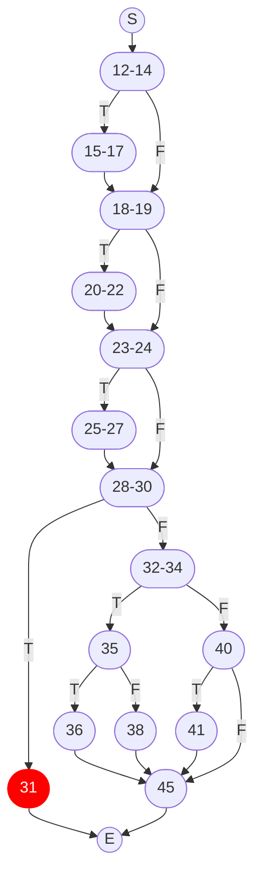
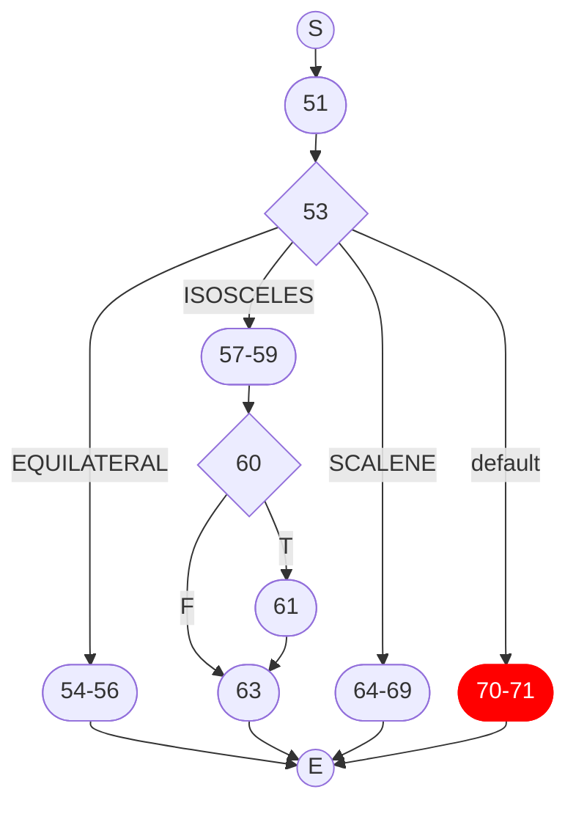

# COM3529 Practical Session 5: Control Flow and Logic Analysis (Solution)

## Exercise 1: Control Flow Graphs (CFGs)

1. The control flow graph (CFG) for the [`Triangle.classify`](../../code/lib/src/main/java/uk/ac/shef/com3529/Triangle.java#L13) method:
   


2. The control flow graph (CFG) for the [`Triangle.generateRandomTriangle`](../../code/lib/src/main/java/uk/ac/shef/com3529/Triangle.java#L50) method:



## Exercise 2: Branch and Path Coverage

The following JUnit tests constitute the answer for this task. Pay attention to the test names and provided comments:

```java
@Test
public void shouldSatisfyBranchCoverageInMisc() {
    assertThat(misc(0, 0, 0), is(0));
    assertThat(misc(1, 1, 1), is(50));
}

@Test
public void shouldSatisfyPathCoverageInMisc() {
    assertThat(misc(0, 0, 0), is(0));
    assertThat(misc(1, 0, 0), is(10));
    assertThat(misc(1, 1, 0), is(40));
    assertThat(misc(1, 1, 1), is(50));
    assertThat(misc(0, 1, 0), is(40));
    assertThat(misc(0, 1, 1), is(50));
    assertThat(misc(0, 0, 1), is(50));
    assertThat(misc(1, 1, 1), is(50));
}

@Test
public void shouldSatisfyBranchCoverageInGCD() {
    assertThat(gcd(14, 21), is(7));
}

@Test
public void shouldSatisfyPathCoverageInGCDWithTwoLoopIterations() {
    // Because the method contains a loop, it is not possible to satisfy path coverage in general
    // But it is possible if we define a bound, e.g., set the number of loop iterations to two
    assertThat(gcd(1, 1), is(1)); // does not enter loop
    assertThat(gcd(4, 2), is(2)); // enters loop once; if-branch
    assertThat(gcd(2, 4), is(2)); // enters loop once; else-branch
    assertThat(gcd(6, 2), is(2)); // enters loop twice; if-branch -> if-branch
    assertThat(gcd(6, 4), is(2)); // enters loop twice; if-branch -> else-branch
    assertThat(gcd(2, 6), is(2)); // enters loop twice; else-branch -> else-branch
    assertThat(gcd(4, 6), is(2)); // enters loop twice; else-branch -> if-branch
}
```

## Exercise 3: Logic Analysis and Testing


The predicate under test is:

```java
if ((side1 + side2 > side3) && // valid triangle
            ((side1 == side2 && side2 != side3) || // first two sides the same
                (side1 != side2 && side2 == side3))) { // last two sides the same
    return Type.ISOSCELES;
}
```

1. Ennumerating the ***atomic conditions*** in the predicate:

<center>

| ID  | Condition | Conjunct |
| --- | --------- | --------: |
| $c_1$  | side1 + side2 \> side3 | 1 |
| $c_2$  | side1 == side2         | 2 |
| $c_3$  | side2 != side3         | 2 |
| $c_4$  | side1 != side2         | 3 |
| $c_5$  | side2 == side3         | 3 |

The logic structure of the predicate is $c_1 \wedge ((c_2 \wedge c_3) \vee (c_4 \wedge c_5))$

</center>

Observe that C2 and C4 are ***mutually exclusive***, meaning they can never be true at the same time.
The same is true for C3 and C5.

2. A test suite satisfying Condition Coverage:


| Test ID | Inputs (`side1`, `side2`, `side3`) | $c_1$ (`side1+side2 > side3`) | $c_2$ (`side1 == side2`) | $c_3$ (`side2 != side3`) | $c_4$ (`side1 != side2`) | $c_5$ (`side2 == side3`) | Decision Output |
| :---: | :---: | :---: | :---: | :---: | :---: | :---: | :---: |
| T1 | `(1, 2, 3)` | FALSE ✓ | FALSE ✓ | TRUE ✓ | TRUE ✓ | FALSE ✓ | FALSE | 
| T3 | `(3, 3, 4)` | TRUE ✓  | TRUE ✓  | TRUE   | FALSE ✓| FALSE   | TRUE |
| T4 | `(3, 4, 4)` | TRUE    | FALSE   | FALSE ✓| TRUE   | TRUE  ✓ | TRUE |

In the above table, '✓' signifies a condition outcome newly covered by the test case.

Observe that only **three** test cases are sufficient to satisfy Condition Coverage.

3. The complete Multiple Condition table is as follows.

To illustrate unfeasible test requirements, we define the following rules:

- $r_0$: All positive integers
- $r_1$: If all sides are equal ($c_2=\text{T} \wedge c_5=\text{T}$), then $c_1$ **must be T**
- $r_2$: $c_2 \neq c_4$
- $r_3$: $c_3 \neq c_5$

<center>

| ID | $c_1$ | $c_2$ | $c_3$ | $c_4$ | $c_5$ | Feasibility | Reason / Outcome | Example Input (Triangle type) |
| :---: | :---: | :---: | :---: | :---: | :---: | :---: | :---: | :--- |
| T1 | F | F | F | F | F | UNFEASIBLE | Violates $r_2$ and $r_3$ | |
| T2 | F | F | F | F | T | UNFEASIBLE | Violates $r_2$ | |
| T3 | F | F | F | T | F | UNFEASIBLE | Violates $r_3$ | |
| T4 | F | F | F | T | T | UNFEASIBLE | Violates $r_0$ | |
| T5 | F | F | T | F | F | UNFEASIBLE | Violates $r_2$ | |
| T6 | F | F | T | F | T | UNFEASIBLE | Violates $r_2$ and $r_3$ |
| T7 | F | F | T | T | F | **FEASIBLE** | **F**  | `(1,2,3)` (Invalid scalene) |
| T8 | F | F | T | T | T | UNFEASIBLE | Violates $r_3$ | |
| T9 | F | T | F | F | F | UNFEASIBLE | Violates $r_3$ | |
| T10 | F | T | F | F | T | UNFEASIBLE | Violates $r_1$ | |
| T11 | F | T | F | T | F | UNFEASIBLE | Violates $r_2$ and $r_3$ | |
| T12 | F | T | F | T | T | UNFEASIBLE | Violates $r_2$ | |
| T13 | F | T | T | F | F | **FEASIBLE** | **F**  | `(1,1,2)` (Invalid isosceles) |
| T14 | F | T | T | F | T | UNFEASIBLE | Violates $r_3$ | |
| T15 | F | T | T | T | F | UNFEASIBLE | Violates $r_2$ | |
| T16 | F | T | T | T | T | UNFEASIBLE | Violates $r_2$ and $r_3$ | |
| T17 | T | F | F | F | F | UNFEASIBLE | Violates $r_2$ and $r_3$ | |
| T18 | T | F | F | F | T | UNFEASIBLE | Violates $r_2$ | |
| T19 | T | F | F | T | F | UNFEASIBLE | Violates $r_3$ | |
| T20 | T | F | F | T | T | **FEASIBLE**   | **T**  | `(3, 4, 4)` (Valid isosceles) |
| T21 | T | F | T | F | F | UNFEASIBLE | Violates $r_2$ |
| T22 | T | F | T | F | T | UNFEASIBLE | Violates $r_2$ and $r_3$ |
| T23 | T | F | T | T | F | **FEASIBLE**   | **F**  | `(2, 3, 4)` (Valid scalene) |
| T24 | T | F | T | T | T | UNFEASIBLE | Violates $r_3$ |
| T25 | T | T | F | F | F | UNFEASIBLE | Violates $r_3$ |
| T26 | T | T | F | F | T | **FEASIBLE** | **F**  | `(3, 3, 3)` (Valid equilateral) |
| T27 | T | T | F | T | F | UNFEASIBLE | Violates $r_2$ and $r_3$ | |
| T28 | T | T | F | T | T | UNFEASIBLE | Violates $r_2$ | |
| T29 | T | T | T | F | F | **FEASIBLE**   | **T**  | `(3, 3, 4)` (Valid isosceles) |
| T30 | T | T | T | F | T | UNFEASIBLE | Violates $r_3$ | |
| T31 | T | T | T | T | F | UNFEASIBLE | Violates $r_2$ | |
| T32 | T | T | T | T | T | UNFEASIBLE | Violates $r_2$ and $r_3$ | |
</center>

The table shows $2^5=32$ combinations in total based on 5 atomic conditions, with only 6 of them being **feasible**, i.e., showing a $6/32=19\%$ maximum achievable MCC coverage.

1. To work on **MCDC**, we start from the six **feasible** combinations identified in the previous task.

<center>

| ID | $c_1$ | $c_2$ | $c_3$ | $c_4$ | $c_5$ | Outcome | Example Input (Triangle Type) |
| :---: | :---: | :---: | :---: | :---:  | :---: | :---: | :--- |
| T7  | F | F | T | T | F | **F**  | `(1, 2, 3)` (Invalid scalene) |
| T13 | F | T | T | F | F | **F**  | `(1, 1, 2)` (Invalid isosceles) |
| T20 | T | F | F | T | T | **T**  | `(3, 4, 4)` (Valid isosceles) |
| T23 | T | F | T | T | F | **F**  | `(2, 3, 4)` (Valid scalene) |
| T26 | T | T | F | F | T | **F**  | `(3, 3, 3)` (Valid equilateral) |
| T29 | T | T | T | F | F | **T**  | `(3, 3, 4)` (Valid isosceles) |

</center>

For MCDC, we aim to find two test cases where only one condition $c_i$ changes value, the overall decision $D$ toggles as well, and all other conditions remain unchanged. However, we must take into account that because $c_2 \neq c_4$ ($r_2$) and $c_3 \neq c_5$ ($r_3$), it is mathematically impossible to toggle $c_2$ without simultaneously toggling $c_4$, or to toggle $c_3$ without simultaneously toggling $c_5$.

To facilitate our task, we sort rows so that all **F** outcomes (IDs 7, 13, 23, 26) are together and all **T** outcomes (IDs 20, 29) are together. This will make it easier to identify toggling conditions affecting the outcome.

<center>

| ID | $c_1$ | $c_2$ | $c_3$ | $c_4$ | $c_5$ | Outcome | Example Input (Triangle Type) |
| :---: | :---: | :---: | :---: | :---:  | :---: | :---: | :--- |
| T7  | F | F | T | T | F | **F**  | `(1, 2, 3)` (Invalid scalene) |
| T13 | F | T | T | F | F | **F**  | `(1, 1, 2)` (Invalid isosceles) |
| T23 | T | F | T | T | F | **F**  | `(2, 3, 4)` (Valid scalene) |
| T26 | T | T | F | F | T | **F**  | `(3, 3, 3)` (Valid equilateral) |
| T20 | T | F | F | T | T | **T**  | `(3, 4, 4)` (Valid isosceles) |
| T29 | T | T | T | F | F | **T**  | `(3, 3, 4)` (Valid isosceles) |

</center>
Next, we work condition by condition to identify pairs of tests where the condition toggles as well as the outcome.

| Condition | Test pair | Explanation |
| :--- | :---: | :--- |
| $c_1$ ($\text{side1} + \text{side2} > \text{side3}$) | (T13, T29) | All other conditions remain unchanged across the two rows. |
| $c_2$ ($\text{side1} == \text{side2}$), coupled with $c_4$ | (T23, T29) | $c_5=\text{F}$ in both rows, masking the also-toggling $c_4$; $c_2$ is shown to directly cause the decision $D$ to toggle. |
| $c_3$ ($\text{side2} \neq \text{side3}$), coupled with $c_5$ | (T26, T29) | The toggling of $c_5$ is masked by $c_4=\text{F}$, which makes the right-hand clause $(c_4 \land c_5)$ evaluates to **F** in both rows. Therefore, toggling $c_3$ directly causes $D$ to toggle. |
| $c_4$ ($\text{side1} \neq \text{side2}$), coupled with $c_2$ | (T26, T20) | Toggling $c_4$ directly causes $D$ to toggle because the toggling of $c_2$ in the left-hand clause $(c_2 \land c_3)$ is masked by $c_3=\text{F}$ in both rows. |
| $c_5$ ($\text{side2} == \text{side3}$), coupled with $c_3$ | (T23, T20) | Because $c_2=\text{F}$ in both rows, the toggling of $c_3$ in the left-hand clause $(c_2 \land c_3)$ is masked; therefore, toggling $c_5$ directly causes $D$ to toggle. |
</center>

This analysis shows that T7 is actually not needed to satisfy MCDC as all conditions are covered by 5 test cases: T13, T23, T26, T20, and T29.


5. The JUnit test suite would look like this:

```java
package uk.ac.shef.com3529;

import org.junit.jupiter.api.Test;

import static org.junit.jupiter.api.Assertions.assertEquals;
import static org.junit.jupiter.api.Assertions.assertNotEquals;
import static org.junit.jupiter.api.Assertions.assertThrows;

public class TriangleTestMCDC {

    @Test
    public void shouldNotClassifyInvalidTriangle_T13() {
        // MCDC T13
        assertThrows(InvalidTriangleException.class, () -> Triangle.classify(1, 1, 2));
    }

    @Test
    public void shouldNotClassifyScalene_23() {
        // MCDC T23
        assertNotEquals(Triangle.Type.ISOSCELES, Triangle.classify(2, 3, 4));
    }

    @Test
    public void shouldNotClassifyEquilateral_T26() {
        // MCDC T26
        assertNotEquals(Triangle.Type.ISOSCELES, Triangle.classify(3, 3, 3));
    }

    @Test
    public void shouldClassifyIsosceles_T20() {
        // MCDC T20
        assertEquals(Triangle.Type.ISOSCELES, Triangle.classify(3, 4, 4));
    }

    @Test
    public void shouldClassifyIsosceles_T29() {
        // MCDC T29
        assertEquals(Triangle.Type.ISOSCELES, Triangle.classify(3, 3, 4));
    }

}
```

You can find and execute these tests in class [TriangleTestMCDC](../../code/lib/src/test/java/uk/ac/shef/com3529/TriangleTestMCDC.java). 

#### Reflection

While line coverage shows which statements are executed and branch coverage shows whether each control-flow outcome has been taken, MCDC requires stronger evidence for how complex decisions are tested: each condition must be shown to affect the decision outcome. While MCDC subsumes branch coverage for the specific conditional on which it is applied, satisfying MCDC for a specific conditional may not guarantee full line or branch coverage of the whole method in which the conditional exists.

This example also shows why coverage requirements must be checked against the actual control flow of the implementation. For instance, while T13 is a feasible combination in the truth table, the implementation of `Triangle.classify` rejects its invalid sides before evaluating the predicate, showing that a logical test requirement is not always necessarily an executable test requirement.

While more thorough analytically, MCDC is more demanding in terms of the number of tests that need writing in our test suites. Keeping one clearly named test per requirement makes tests easier to trace and review, but introduces further challenges for readability understandability, since code refactorings may lead to out-of-sync test names. Additionally, MCDC evidence comes from comparing pairs of tests, as individual tests alone do not demonstrate that a condition toggles the decision, but unit tests need to be atomic and independent. This mismatch can make it challenging to track which pairs of tests are needed to satisfy MCDC. One way to mitigate this would be to combine pairs of tests in each unit test, but this would in itself be problematic, as the intent of each unit test would be less clear, and failures or coverage gaps would be harder to diagnose.